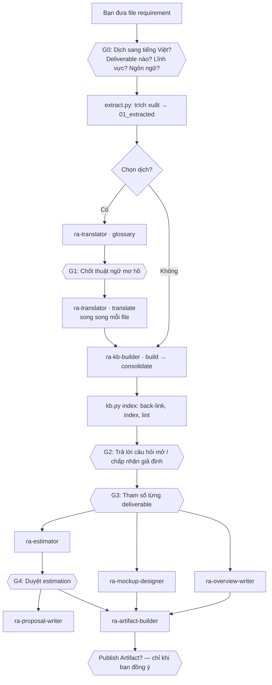
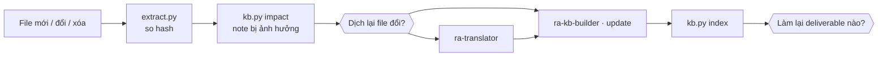

# TanaSubagent — Requirement Analyst cho Claude Code

Bộ **skill + subagent cho Claude Code** dùng trong giai đoạn presale / phân tích yêu cầu của dự án phần mềm.
Từ các tài liệu khách hàng gửi (RFP, SRS, spec, backlog, slide kickoff…), bộ công cụ tự động:

- trích xuất nội dung từ nhiều định dạng, giữ mốc vị trí để truy vết về đúng đoạn/slide/dòng gốc;
- dịch sang tiếng Việt sát nghĩa, thống nhất thuật ngữ chuyên ngành của dự án;
- dựng **hệ thống tri thức có back-link** để tra cứu lại nghiệp vụ nhanh, nhiều lần;
- tạo tài liệu tổng quan hệ thống, mockup, trang HTML trình bày, estimation và proposal báo giá;
- luôn **hỏi con người ở các điểm quyết định** thay vì tự đoán.

| Thành phần | Mô tả |
|---|---|
| Skill `req-analyst` | quy trình điều phối, chạy trong session Claude Code bạn đang chat |
| 8 subagent `ra-*` | dịch, dựng KB, viết tổng quan, mockup, artifact, estimation, proposal, hỏi đáp |
| 3 script Python | trích xuất tài liệu, quản lý KB, tính estimation — chỉ dùng thư viện chuẩn |

**Bắt đầu nhanh:** clone repo, mở Claude Code tại thư mục repo (hoặc chép thư mục `.claude/` vào project của bạn),
đặt file requirement vào một thư mục rồi gõ:

```
/req-analyst phân tích requirement trong thư mục docs/rfp
```

---

# Hướng dẫn sử dụng skill `req-analyst`

Skill `req-analyst` biến các file requirement (txt, md, docx, pptx, xlsx/xlsm, csv, pdf) thành:

1. **Bản dịch tiếng Việt sát nghĩa** kèm bảng thuật ngữ dự án (nếu bạn chọn dịch).
2. **Hệ thống tri thức (KB)** dạng note Markdown có liên kết `[[ID]]` và back-link, để tra cứu lại nghiệp vụ nhanh.
3. **Deliverable**: tổng quan hệ thống, mockup, artifact HTML, estimation, proposal.

Skill luôn **hỏi bạn trước** ở các điểm quyết định (Gate) và không tự đoán những thứ ảnh hưởng tới kết quả.

---

## 1. Cài đặt & thành phần

Không cần cài thêm thư viện: các script chỉ dùng Python 3 chuẩn. Tùy chọn:

| Công cụ | Dùng cho | Không có thì |
|---|---|---|
| `pdftotext` (poppler-utils) | đọc PDF | PDF bị báo `failed` |
| LibreOffice (`soffice`) | đọc `.doc`, `.ppt`, `.xls` đời cũ | cần lưu lại dạng docx/pptx/xlsx |
| `openpyxl` | xuất thêm `estimation.xlsx` | chỉ có bản Markdown/CSV |

```
.claude/
├── skills/req-analyst/
│   ├── SKILL.md                         quy trình điều phối (orchestrator đọc file này)
│   ├── scripts/
│   │   ├── extract.py                   trích xuất file requirement → Markdown có mốc vị trí
│   │   ├── kb.py                        init / index / search / show / next-id / impact
│   │   └── estimate.py                  tổng hợp estimation từ WBS (Decimal)
│   └── templates/
│       ├── kb_note.md                   mẫu một note KB
│       ├── system_overview.md           khung tài liệu tổng quan
│       ├── proposal.md                  khung proposal
│       └── estimation_config.example.json  mẫu tham số estimation
└── agents/
    ├── ra-translator.md        ├── ra-mockup-designer.md
    ├── ra-kb-builder.md        ├── ra-artifact-builder.md
    ├── ra-overview-writer.md   ├── ra-estimator.md
    ├── ra-proposal-writer.md   └── ra-kb-qa.md
```

---

## 2. Cách kích hoạt

Mở Claude Code tại thư mục project này, rồi dùng một trong các cách:

| Bạn gõ | Skill làm gì |
|---|---|
| `/req-analyst` | bắt đầu (hoặc tiếp tục) quy trình |
| "Phân tích requirement trong thư mục `docs/rfp`" | bắt đầu với thư mục đó |
| "Dịch tài liệu yêu cầu này sang tiếng Việt" | chạy tới bước dịch + glossary |
| "Làm estimate / viết proposal cho RFP này" | chạy đủ các bước cần thiết rồi tới deliverable đó |
| "Quy tắc hủy đơn trong dự án là gì?" (khi đã có KB) | chế độ hỏi đáp nghiệp vụ |
| "Khách gửi bản spec v2, cập nhật lại" | chế độ cập nhật khi requirement thay đổi |

Skill được Claude tự chọn khi yêu cầu khớp mô tả của nó (phân tích/dịch requirement, dựng KB, estimate, proposal, mockup,
hỏi lại nghiệp vụ). Gõ `/req-analyst` là cách chắc chắn nhất.

**Vai trò:** session Claude bạn đang chat là **orchestrator** (điều phối). Nó hỏi bạn, chạy script, giao việc cho subagent,
kiểm tra kết quả. Subagent **không thấy hội thoại** — orchestrator truyền cho chúng đường dẫn workspace, file cần làm và các
quyết định của bạn.

---

## 3. Workspace

Mặc định `req-workspace/<tên-dự-án>/` ở thư mục gốc project:

```
req-workspace/<du-an>/
├── 00_input/                 (tùy chọn) bản sao file requirement
├── 01_extracted/             <slug>.md + manifest.json (hash từng file)
├── 02_translated/            <slug>.vi.md + _new_terms/<slug>.md
├── glossary.md               bảng thuật ngữ — chuẩn cho mọi bản dịch & deliverable
├── kb/
│   ├── modules/ features/ actors/ rules/ entities/ screens/
│   ├── integrations/ nfr/ processes/ questions/ assumptions/ decisions/
│   ├── sources/              SRC-*.md (sinh tự động, mỗi file nguồn một note)
│   ├── index.md              mục lục (sinh tự động)
│   └── _lint.md              báo cáo liên kết hỏng, note thiếu nguồn, câu hỏi mở (sinh tự động)
├── deliverables/
│   ├── overview/ mockups/ artifact/ estimation/ proposal/
└── state.json                giai đoạn hiện tại + mọi quyết định của bạn
```

Nhờ `state.json`, bạn có thể dừng giữa chừng và gọi lại `/req-analyst` hôm sau — skill tiếp tục từ chỗ dở, không hỏi lại
điều đã chốt.

---

## 4. Luồng chạy tổng thể



Hình lục giác = **Gate**: skill dừng lại, hỏi bạn bằng hộp chọn, và **chờ** câu trả lời.

### 4.1 Các Gate — skill sẽ hỏi gì

| Gate | Khi nào | Hỏi gì | Câu trả lời lưu ở |
|---|---|---|---|
| **G0** | Ngay đầu, trước khi đọc nội dung | Dịch sang tiếng Việt? (có / không / chỉ glossary) · Deliverable cần tạo · Tên dự án & lĩnh vực · Ngôn ngữ deliverable | `state.json` |
| **G1** | Sau khi lập glossary | Chọn cách dịch cho ~15 thuật ngữ mơ hồ | `glossary.md` (trạng thái `đã duyệt`) |
| **G2** | Sau khi dựng KB, trước mọi deliverable | Câu hỏi mở quan trọng nhất + giả định đề xuất; hoặc "chấp nhận toàn bộ giả định" / "gửi khách hàng trước, tạm dừng" | note `D-xxx`, `Q-xxx → answered`, `AS-xxx → accepted` |
| **G3** | Trước khi giao subagent làm deliverable | Tham số của từng deliverable đã chọn (xem bảng dưới) | `state.json`, `estimation_config.json` |
| **G4** | Sau khi có estimation, trước proposal | Duyệt / điều chỉnh / ước lượng lại phần nào | `state.json` |
| Publish | Sau khi có artifact HTML | Có publish thành link Artifact riêng tư không | `state.json` |

Tham số hỏi ở **G3**:

| Deliverable | Tham số |
|---|---|
| Tổng quan hệ thống | đối tượng đọc, mức chi tiết, có đề xuất kiến trúc/tech stack không |
| Mockup | web / mobile / cả hai, wireframe xám hay có màu brand, màn hình nào |
| Artifact HTML | phần nào đưa vào, có publish không |
| Estimation | phương pháp (WBS 3 điểm / Function Point / Use Case Point), đơn vị, vai trò & đơn giá, tiền tệ, % buffer, % overhead PM/QA, giai đoạn nằm trong phạm vi |
| Proposal | công ty gửi, khách hàng, mô hình hợp đồng (trọn gói / T&M / ODC), điều khoản thanh toán, định dạng (Markdown / .docx / Claude Doc / slide) |

---

## 5. Các subagent

Tóm tắt khi nào subagent được kích hoạt:

| Subagent | Kích hoạt khi | Chạy song song? | Model |
|---|---|---|---|
| `ra-translator` | G0 chọn dịch hoặc chỉ glossary; requirement đổi và bạn muốn dịch lại | glossary: 1 agent; translate: mỗi file/phần 1 agent | mặc định |
| `ra-kb-builder` | luôn chạy sau trích xuất (và sau dịch); khi requirement thay đổi; khi lint KB còn lỗi | build: chia theo nhóm file, dải ID riêng; consolidate/update: 1 agent | mặc định |
| `ra-overview-writer` | G0 chọn "Tổng quan hệ thống", sau G2 + G3 | có (đợt 1) | mặc định |
| `ra-mockup-designer` | G0 chọn "Mockup", sau G2 + G3 | có (đợt 1) | mặc định |
| `ra-estimator` | G0 chọn "Estimation", sau G2 + G3; chạy lại nếu G4 yêu cầu điều chỉnh | có (đợt 1) | mặc định |
| `ra-proposal-writer` | G0 chọn "Proposal", **chỉ sau khi G4 duyệt estimation** | có (đợt 2) | mặc định |
| `ra-artifact-builder` | G0 chọn "Artifact HTML", sau khi overview/mockup (và estimation nếu cần) xong | có (đợt 2) | mặc định |
| `ra-kb-qa` | bạn hỏi lại nghiệp vụ và câu trả lời cần tổng hợp nhiều note | — | sonnet (rẻ, chỉ đọc) |

Mọi subagent có quyền `Read, Write, Edit, Grep, Glob, Bash`, riêng `ra-kb-qa` chỉ đọc (`Read, Grep, Glob, Bash`, không sửa file).

### 5.1 `ra-translator` — dịch & bảng thuật ngữ

**Hoạt động:** hai chế độ.
- `glossary`: quét toàn bộ tài liệu tìm thuật ngữ nghiệp vụ, vai trò, thực thể, trạng thái, màn hình, viết tắt → lập bảng
  thuật ngữ, đánh dấu `đề xuất` hoặc `cần xác nhận` (nhiều cách dịch). Tên riêng, mã, tên cột DB không dịch; thuật ngữ IT quen
  dùng (API, batch, role…) giữ nguyên.
- `translate`: dịch đủ từng câu, không tóm tắt/thêm ý; giữ mức bắt buộc (must/shall → "phải", should → "nên", may → "có thể");
  lần đầu thuật ngữ xuất hiện trong mỗi mục ghi kèm gốc, ví dụ "đơn đặt hàng (Purchase Order – PO)"; câu mơ hồ thêm
  `[Ghi chú dịch: … nguyên văn: "…"]`. Tự kiểm số mốc `[pN]`/`[slideN]`/Row và số dòng bảng bằng bản gốc.

| | Nội dung |
|---|---|
| **Input** | `WS`, chế độ, danh sách `01_extracted/<slug>.md` (có thể kèm khoảng dòng nếu file lớn), lĩnh vực, thuật ngữ đã chốt, `glossary.md` |
| **Output** | glossary: `WS/glossary.md` · translate: `WS/02_translated/<slug>.vi.md` (hoặc `<slug>.part-N.vi.md`), thuật ngữ mới ở `WS/02_translated/_new_terms/<slug>.md` |
| **Báo cáo về orchestrator** | file đã ghi, số đoạn/bảng, số thuật ngữ mới, ghi chú dịch ảnh hưởng nghiệp vụ |

Thuật ngữ mới không ghi thẳng vào glossary (tránh ghi đè khi chạy song song); orchestrator gộp và hỏi bạn nếu xung đột.

### 5.2 `ra-kb-builder` — dựng hệ thống tri thức

**Hoạt động:** đọc bản dịch (hoặc bản trích xuất), tạo mỗi khái niệm một note có ID, liên kết các note với nhau, ghi nguồn
`[[SRC-...]]` + mốc vị trí cho mọi khẳng định. Thông tin suy luận → `AS-xxx`; thiếu/mơ hồ/mâu thuẫn → `Q-xxx` (kèm vì sao quan
trọng, phương án, giả định đề xuất). Cuối cùng chạy `kb.py index` và sửa tới khi `_lint.md` sạch.

Ba chế độ:
- `build`: tạo note từ các file được giao (bắt đầu bằng module).
- `consolidate`: gộp note trùng nghĩa (note bị gộp → `deprecated`), bổ sung link chéo.
- `update`: khi requirement đổi — sửa note (`status: changed` + lịch sử cũ → mới), tạo note mới, nội dung bị xóa → `deprecated`.

| Loại note | ID | Nội dung |
|---|---|---|
| module | `M-001` | phân hệ, mục tiêu, danh sách chức năng |
| feature | `F-001` | mô tả, luồng chính/ngoại lệ, đầu vào/ra, ưu tiên |
| actor | `A-001` | vai trò, quyền |
| rule | `BR-001` | một quy tắc/validation/công thức |
| entity | `E-001` | thuộc tính, quan hệ, vòng đời trạng thái |
| screen | `S-001` | mục đích, thành phần, hành động, điều hướng |
| integration | `I-001` | hệ thống ngoài, hướng, giao thức, tần suất |
| nfr | `NFR-001` | hiệu năng, bảo mật, khả dụng… |
| process | `P-001` | quy trình đầu-cuối |
| question | `Q-001` | câu hỏi mở |
| assumption | `AS-001` | giả định |
| decision | `D-001` | câu trả lời đã chốt từ bạn |
| source | `SRC-<slug>` | sinh tự động bởi script |

| | Nội dung |
|---|---|
| **Input** | `WS`, chế độ, danh sách file nguồn, dải ID được cấp (khi chạy song song), ngôn ngữ ghi note; với `update`: file đổi + note bị ảnh hưởng |
| **Output** | `WS/kb/<loại>/<ID>.md`; sau `kb.py index`: khối back-link trong mỗi note, `kb/sources/SRC-*.md`, `kb/index.md`, `kb/_lint.md` |
| **Báo cáo** | số note tạo/sửa theo loại, 5–10 câu hỏi mở quan trọng nhất, vấn đề còn tồn tại |

### 5.3 `ra-overview-writer` — tổng quan hệ thống

**Hoạt động:** đọc KB theo thứ tự module → feature → actor → process → entity → integration → nfr → giả định/câu hỏi; viết
theo khung `templates/system_overview.md` với sơ đồ Mermaid (ngữ cảnh, quy trình, ERD). Mọi mục kèm `[[ID]]`; chỗ chưa rõ ghi
"(giả định [[AS-xxx]])" hoặc "(chưa rõ — [[Q-xxx]])". Kiến trúc chỉ đưa vào khi bạn đã chọn ở G3.

| | Nội dung |
|---|---|
| **Input** | `WS`, ngôn ngữ, đối tượng đọc, mức chi tiết, tech stack (nếu có) |
| **Output** | `WS/deliverables/overview/system-overview.md` (12 mục, gồm ma trận truy vết nguồn → F → S/BR/E) |
| **Báo cáo** | số mục/sơ đồ, các điểm còn trống do thiếu thông tin |

### 5.4 `ra-mockup-designer` — mockup

**Hoạt động:** với mỗi màn hình `S-xxx` (và feature, entity, rule liên quan), tạo một trang HTML/CSS thuần, dữ liệu mẫu tiếng
Việt khớp thực thể, thông báo lỗi theo quy tắc validation, điều hướng theo luồng nghiệp vụ. Mỗi trang có khung chú thích:
feature, quy tắc (đánh số ①②), câu hỏi mở, nguồn. Màn hình phải tự suy luận được đánh dấu "suy luận".

| | Nội dung |
|---|---|
| **Input** | `WS`, nền tảng, độ trung thực, danh sách màn hình, ngôn ngữ hiển thị |
| **Output** | `WS/deliverables/mockups/index.html`, `S-xxx.html`, `assets/style.css` |
| **Báo cáo** | số màn hình, màn hình suy luận cần xác nhận, trường/hành vi chưa rõ |

### 5.5 `ra-estimator` — estimation

**Hoạt động:** lập WBS chia nhỏ 0.5–5 man-day/hạng mục (màn hình, API, batch, báo cáo, tích hợp, migration, NFR, các hạng
mục chung trong phạm vi). Mỗi hạng mục bắt buộc có `kb_refs` (truy vết về KB) và ghi giả định nếu dựa trên `AS`/`Q`. Không tự
đổi đơn giá/buffer/overhead. Chạy `estimate.py` để tính tổng (không cộng tay), sửa tới khi hết lỗi dữ liệu.

| | Nội dung |
|---|---|
| **Input** | `WS`, `deliverables/estimation/estimation_config.json` (đã duyệt ở G3), phương pháp, phạm vi giai đoạn, tech stack |
| **Output** | `wbs.csv` (cột `id,module,feature,task,phase,role,effort,kb_refs,assumption`), `wbs_detail.csv` (O/M/P nếu 3 điểm) hoặc `fp_count.md`/`ucp_count.md`, `estimation_summary.md` + `.json` (do script), `estimation.md` (phương pháp, tổng, rủi ro, giả định, lịch đề xuất), `estimation.xlsx` nếu có openpyxl |
| **Báo cáo** | tổng effort/chi phí đúng như script in, 3–5 rủi ro/giả định lớn nhất, điểm cần bạn duyệt |

Sau đó orchestrator dừng ở **G4** để bạn duyệt. Nếu điều chỉnh, estimator được gửi lại và chạy lại script.

### 5.6 `ra-proposal-writer` — proposal

**Hoạt động:** viết theo khung `templates/proposal.md` (tóm tắt điều hành, hiểu biết yêu cầu, phạm vi in/out, giải pháp,
kế hoạch, đội dự án, chi phí, giả định, rủi ro, bảo hành, phụ lục). Số liệu chi phí/tiến độ **chép đúng** từ
`estimation_summary.json`. Thân proposal không chứa ID nội bộ `[[...]]`; bản truy vết riêng cho nội bộ. Năng lực công ty, dự án
tham chiếu để placeholder `{{…}}`, không bịa.

| | Nội dung |
|---|---|
| **Input** | `WS`, công ty gửi, khách hàng, mô hình hợp đồng, điều khoản thanh toán, ngôn ngữ, định dạng; overview, estimation đã duyệt, mockup, KB |
| **Output** | `WS/deliverables/proposal/proposal.md`, `proposal.trace.md` (mục → ID KB/nguồn). Nếu cần .docx/Claude Doc, orchestrator chuyển đổi bằng skill `docx`/`docs` |
| **Báo cáo** | placeholder cần điền, điểm cần kiểm tra lại (pháp lý, điều khoản) |

### 5.7 `ra-artifact-builder` — trang HTML trình bày

**Hoạt động:** đóng gói tổng quan, sơ đồ (Mermaid), bảng chức năng có bộ lọc và chi tiết, thư viện mockup, estimation, câu hỏi
mở vào **một file HTML tự chứa**, responsive, có dark mode. Chỉ lấy nội dung từ KB/deliverable. **Không publish** — việc publish
do orchestrator làm và chỉ khi bạn đồng ý.

| | Nội dung |
|---|---|
| **Input** | `WS`, các phần cần đưa vào, ngôn ngữ; overview, KB, mockups, `estimation_summary.json` (nếu yêu cầu) |
| **Output** | `WS/deliverables/artifact/index.html` |
| **Báo cáo** | đường dẫn, kích thước, phần đã đưa vào/bỏ qua |

### 5.8 `ra-kb-qa` — hỏi đáp nghiệp vụ

**Hoạt động:** tra glossary để có cả thuật ngữ Việt và gốc → `kb.py search` → `kb.py show` → đi theo link/back-link tới khi đủ
trả lời. Ưu tiên `D-xxx` (đã chốt) hơn tài liệu gốc; nói rõ nếu note đã `changed/deprecated`. Không sửa file.

| | Nội dung |
|---|---|
| **Input** | `WS`, câu hỏi |
| **Output** | câu trả lời trực tiếp + căn cứ (`ID — tiêu đề` + `file gốc [mốc]`); nếu tài liệu không đề cập thì nói rõ và đề xuất câu hỏi `Q-xxx` |

Câu hỏi đơn giản orchestrator tự trả lời bằng `kb.py`, không cần gọi agent này.

---

## 6. Script (có thể chạy tay)

Đặt `S=.claude/skills/req-analyst/scripts` và `WS=req-workspace/<du-an>`.

| Lệnh | Tác dụng |
|---|---|
| `python3 $S/kb.py init $WS` | tạo cấu trúc workspace, `state.json`, `glossary.md` rỗng |
| `python3 $S/extract.py <thư mục/file> $WS` | trích xuất; in JSON `new / changed / unchanged / removed / failed`; chỉ xử lý lại file đổi hash |
| `python3 $S/kb.py index $WS` | sinh note `SRC-*`, back-link, `index.md`, `_lint.md` |
| `python3 $S/kb.py search $WS <từ khóa...>` | tìm nguyên từ, không phân biệt dấu, trong KB (ưu tiên) → glossary → bản dịch → bản trích xuất |
| `python3 $S/kb.py show $WS F-001` | xem note + các note nó trỏ tới + các note trỏ tới nó |
| `python3 $S/kb.py next-id $WS feature` | ID kế tiếp (`F-002`…) |
| `python3 $S/kb.py impact $WS` | sau lần extract mới: file nào đổi/xóa → những note nào bị ảnh hưởng |
| `python3 $S/estimate.py wbs.csv estimation_config.json <out_dir>` | tính tổng effort, overhead, buffer, chi phí; báo lỗi ID trùng, effort sai, role/phase lạ, thiếu `kb_refs` |

**Mốc vị trí nguồn** trong bản trích xuất (dùng để trích dẫn):

| Mốc | Ý nghĩa |
|---|---|
| `[p12]` | đoạn thứ 12 trong Word |
| `[table2]` | bảng thứ 2 trong Word |
| `[slide3]`, `[slide3-table1]`, `[slide3-notes]` | slide, bảng trong slide, speaker notes |
| `[sheet:Backlog]` + cột `Row` | sheet Excel và số dòng gốc |
| `[page4]` | trang PDF |

---

## 7. Hỏi lại nghiệp vụ

Sau khi KB đã có, chỉ cần hỏi tự nhiên:

> "Ai được hủy đơn sau khi duyệt?" · "F-012 liên quan những màn hình nào?" · "Có quy tắc nào về hoàn tiền không?"

Câu trả lời luôn kèm ID note và nguồn (file + mốc). Nếu tài liệu chưa đề cập, skill nói rõ và đề xuất tạo câu hỏi `Q-xxx`;
nếu bạn trả lời luôn, câu trả lời được lưu thành `D-xxx` để lần sau dùng lại.

Có thể mở thư mục `kb/` bằng Obsidian để xem graph và back-link trực quan (định dạng `[[ID]]` tương thích).

---

## 8. Khi requirement thay đổi



Skill báo deliverable nào bị ảnh hưởng và **hỏi trước** khi làm lại. Cần so sánh chi tiết từng ô/đoạn giữa hai phiên bản thì
dùng skill `dcia-orchestrator`.

---

## 9. Nguyên tắc chất lượng

- **Truy vết:** mọi khẳng định trong KB/deliverable dẫn về `[[SRC-...]]` + mốc, hoặc `[[D-xxx]]`. Không có nguồn → là giả
  định hoặc câu hỏi, không trình bày như sự thật.
- **Không bịa số liệu:** estimation/proposal chỉ dùng tham số bạn đã duyệt; tổng do script tính.
- **Hỏi trước khi làm:** mọi Gate đều chờ câu trả lời; mọi quyết định được ghi lại.

## 10. Xử lý sự cố

| Hiện tượng | Cách xử lý |
|---|---|
| `failed: cần LibreOffice để đọc .doc` | cài LibreOffice hoặc lưu lại file dạng docx/pptx/xlsx |
| `failed: thiếu pdftotext` | cài `poppler-utils` |
| PDF scan ra trang trống | PDF là ảnh — nhờ Claude OCR bằng skill `pdf` |
| Chữ trong ảnh/sơ đồ nhúng bị thiếu | gửi riêng ảnh để Claude đọc trực tiếp |
| `_lint.md` có liên kết hỏng | yêu cầu "sửa lỗi KB" — orchestrator gửi lại `ra-kb-builder` |
| `estimate.py` báo lỗi dữ liệu | estimator sửa `wbs.csv` rồi chạy lại; không gửi khách khi còn lỗi |
| Muốn đổi đơn giá/buffer sau khi duyệt | nói rõ giá trị mới — skill cập nhật config, chạy lại estimation, hỏi duyệt lại (G4) |
